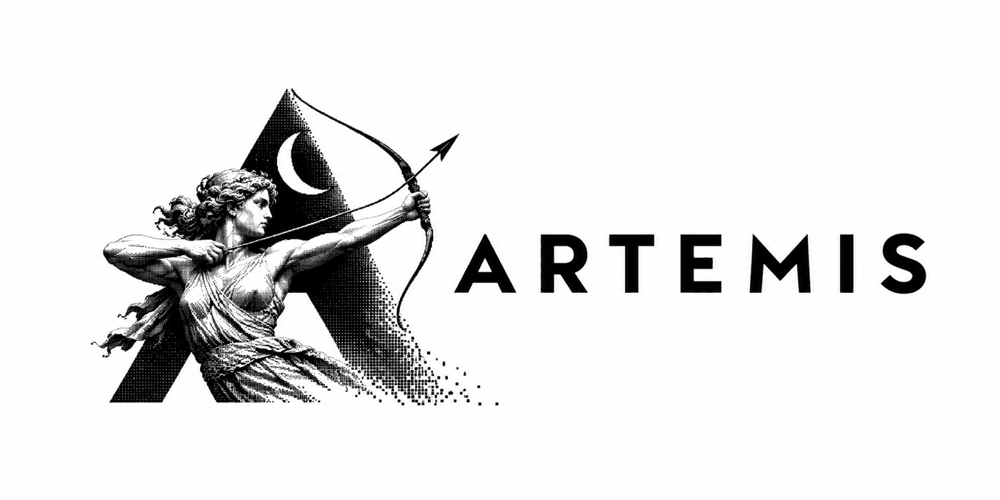
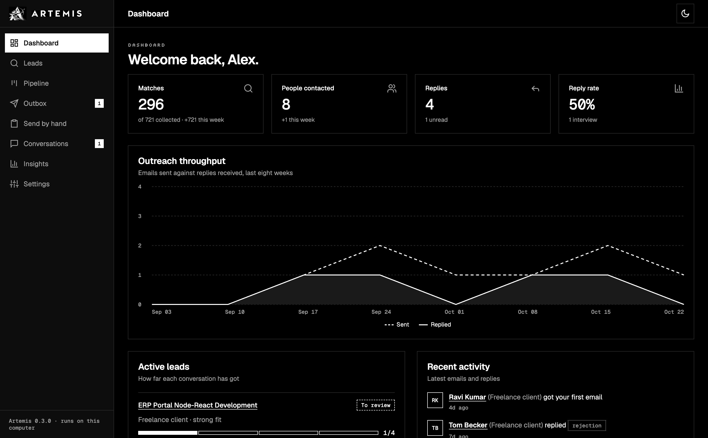
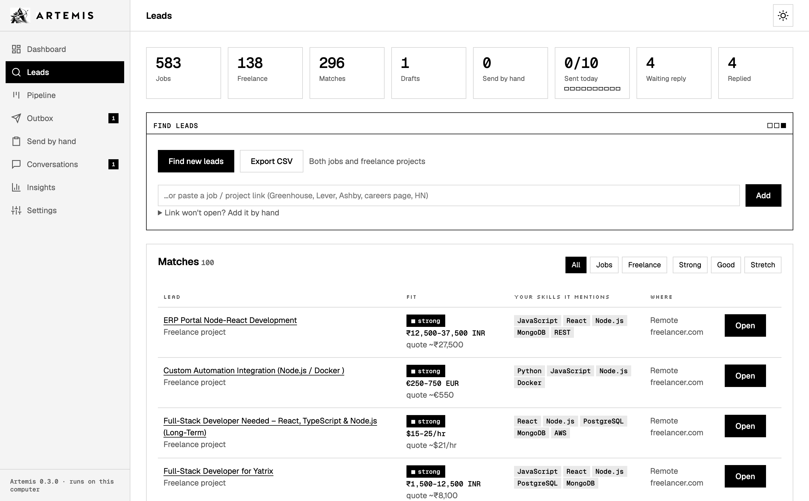
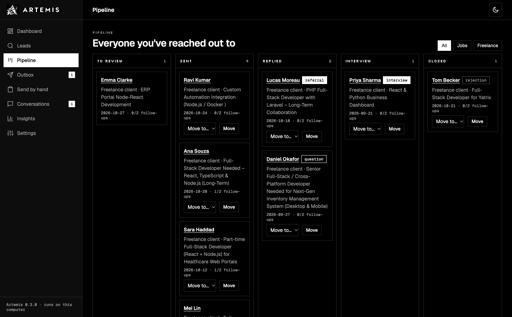

<p align="center"></p>

<p align="center"><b>Your own job-hunting and freelance agent that runs on your computer.</b></p>

Give it your resume. It finds matching jobs and client projects, finds the right person to contact, writes the email or
proposal, sends it from your own Gmail after you approve it, and follows up until they answer.

[](https://github.com/Manideep-Ai-ai/artemis/actions/workflows/ci.yml)


No subscription, no account, no server. Your resume, contacts and keys stay on your machine.



## Why

Applying through job boards means competing with hundreds of people for a recruiter's attention. A short, specific
email to the right recruiter or hiring manager gets read. Doing that by hand for every opening takes hours.
Artemis does the searching, matching, finding and writing, and leaves the decisions to you.

## What it does

| | Jobs | Freelance |
|---|---|---|
| **Finds leads** | Greenhouse, Lever, Ashby, SmartRecruiters and Recruitee company boards, Remotive, Arbeitnow, *Hacker News: Who is hiring?*, or any link you paste | Freelancer.com projects, contract posts on HN, or any link |
| **Matches** | Your skills, experience, roles and cities, and shows *why* it matched | Skills plus budget against your minimum rate, with a suggested quote |
| **Finds who to contact** | The email in the post, plus a recruiter and the team's manager found through web search | The client's email from the post, or a proposal to paste on the site |
| **Writes** | A short email from your resume, your projects and your own notes (AI or template) | A proposal that names your most relevant project, with its link |
| **Sends** | From your Gmail, resume attached, working hours only, **max 10 a day**, only after you approve | Same |
| **Follows up** | Day 4 and day 7 in the same thread; stops on reply or bounce | Same |
| **Tracks** | Replies tagged *interview, referral, question, rejection*; a Pipeline board, Insights, and optional Telegram alerts | Same |

<table>
<tr><td></td><td></td></tr>
<tr><td align="center">Leads, ranked by fit</td><td align="center">Pipeline: everyone you've reached out to</td></tr>
</table>

## Quick start

You need Python 3.10 or newer.

```bash
git clone https://github.com/Manideep-Ai-ai/artemis.git
cd artemis
python -m venv .venv && source .venv/bin/activate      # Windows: .venv\Scripts\activate
pip install -e .
leadhunter web                                          # open http://127.0.0.1:8765
```

The command is `leadhunter` (the project's original name). A setup wizard opens on first visit:

1. **Goal:** job hunting, freelance clients, both, or just collect leads.
2. **About you:** upload your resume; it reads your skills. Add the projects you've built.
3. **Gmail:** your address and a Gmail [App Password](https://myaccount.google.com/apppasswords). This is a
   16-letter code from Google, *not* your Gmail password.
4. **Power-ups (optional):** web search, AI writing, Hunter.io, Telegram alerts.

Artemis starts in **practice mode**: emails are saved to `./outbox/*.eml` instead of sent, so you can read exactly
what would go out. Untick it in Settings when you're happy.

Prefer the terminal? Run `leadhunter` for a guided menu, or see [all commands](#terminal).

## Keys (all have free tiers)

Only Gmail is needed to send. Everything else makes it better.

| What | Why | Where |
|---|---|---|
| **Gmail App Password** | Send from your Gmail and read replies | [myaccount.google.com/apppasswords](https://myaccount.google.com/apppasswords) (turn on 2-Step Verification first) |
| **Web search** | Find the recruiter and hiring manager | [Brave Search API](https://brave.com/search/api/) or [Tavily](https://tavily.com), or self-hosted [SearXNG](https://docs.searxng.org) |
| **AI writing** | More personal emails and proposals | [Gemini](https://aistudio.google.com/apikey), [Groq](https://console.groq.com/keys), or [Ollama](https://ollama.com) offline |
| **Hunter.io** | Exact company email formats, fewer bounces | [hunter.io/api-keys](https://hunter.io/api-keys) |
| **Telegram** | A ping on your phone when someone replies | Make a bot with [@BotFather](https://t.me/BotFather), send it "hi"; Artemis finds your chat ID |

Keys are saved only in `.env` on your computer. Artemis checks them when it starts and when you click
**Check all keys now**. If one expires, is deleted, runs out of credits, or its AI model is retired, a warning
appears at the top of the dashboard and in `leadhunter doctor`, with a link to fix it.

## Make it sound like you

- **Projects you've built:** in Settings, one per line: `SignAI | https://signai.in | AI recruitment ERP`.
  Each email or proposal mentions the project that best fits the post, with its link.
- **Your notes on a lead:** tell Artemis what to say ("mention I shipped CrewAI agents in production, offer a paid
  discovery call"). It rewrites the unsent drafts with your notes.
- **Edit anything:** every draft and proposal is editable before it goes out.

## Safety rails

- **You approve every first email.** Nothing is sent on its own until you say so.
- **Max 10 emails a day** by default, follow-ups included. The code refuses to go above 20.
- **Weekdays and working hours only,** with random gaps between sends.
- **One thread per person.** Bounced or replied addresses are never emailed again.
- **No LinkedIn or freelance-site automation.** Those sites ban it. Artemis writes the note or proposal and opens the
  page; you click send.
- **Local data.** Everything lives in `leadhunter.db` on your computer. No telemetry.

You're responsible for the emails you send. Cold-email rules differ by country (India's DPDP Act, US CAN-SPAM,
EU GDPR). This isn't legal advice.

## How it finds the right person

For a *Backend Engineer* job at *Accenture* in *Hyderabad*, it searches the web for:

```
site:linkedin.com/in "Accenture" ("talent acquisition" OR recruiter) "Hyderabad"
site:linkedin.com/in "Accenture" ("engineering manager" OR "head of backend") "Hyderabad"
```

It reads names and headlines **from the search results** (it never logs into LinkedIn), keeps people who work there
now, and ranks them by role, city and team. Emails follow the company's pattern (`first.last@accenture.com`, from
Hunter or public examples) and are labelled **posted**, **verified**, **likely** or **guessed**. Guessed addresses
always wait for your approval.

## Terminal

```bash
leadhunter                    # guided menu
leadhunter doctor             # check setup and test every key
leadhunter collect            # find new leads
leadhunter jobs --fit strong  # best matches
leadhunter research 12        # reach out on lead #12: find people, write drafts
leadhunter drafts             # read drafts
leadhunter approve 4 5        # or: approve all
leadhunter send               # follow-ups first, then approved emails
leadhunter check              # look for replies and bounces
leadhunter status             # pipeline summary
leadhunter run                # hands-off: find leads every 6h, send and follow up every 15 min
leadhunter --help             # everything else
```

The dashboard and the terminal share the same database, so you can use both.

## Project layout

```
leadhunter/
  web.py, web_pages.py   dashboard and setup wizard (server-rendered HTML, no JS build)
  theme.py, static/      the Artemis look: black and white, light and dark
  terminal.py, cli.py    guided terminal session and one-shot commands
  agent.py               the pipeline: collect, reach out, approve, send, follow up
  sources.py, freelance.py, joblink.py   where leads come from
  matching.py, resume.py                 fit scores and skills
  search.py, research.py, emails.py      finding people and their emails
  compose.py             emails, proposals, LinkedIn notes, follow-ups
  mailer.py              Gmail send, reply and bounce detection
  keyhealth.py           is each key still working?
  insights.py, db.py, config.py
tests/                   pytest suite, runs offline
```

## Contributing

Issues and pull requests are welcome. Good first issues: a new job source (Workable, RemoteOK), more skill aliases,
email templates in other languages. Read [CONTRIBUTING.md](CONTRIBUTING.md) first; tests run offline:

```bash
pip install -e ".[dev]" && pytest
```

## Roadmap

- [ ] Chrome extension: "Reach out with Artemis" on any job page
- [ ] Gmail sign-in (OAuth) as an alternative to App Passwords
- [ ] More sources: Workable, RemoteOK
- [ ] Docker image and one-click installers
- [x] Reply tagging, Pipeline board, Insights, Telegram alerts
- [x] Key health warnings in the dashboard and terminal

If Artemis helps you land an interview or a client, a ⭐ helps other people find it.

## License

[MIT](LICENSE). Free to use, change and share.
